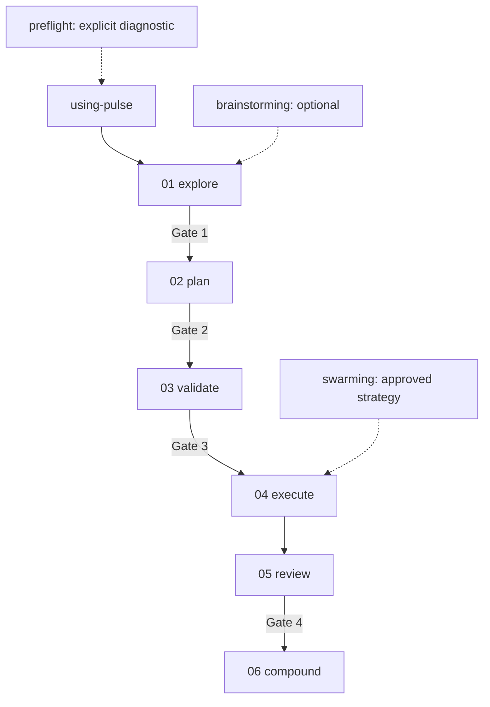

# Pulse 4 Architecture

Pulse 4 applies Interpretable Context Methodology to software delivery: folder structure defines the stages, plain files carry context, deterministic scripts handle mechanics, and humans approve the irreversible boundaries.

## Five Context Layers

1. **Identity** — `AGENTS.md` and `CLAUDE.md` explain the repository and durable rules.
2. **Routing** — `workflow/CONTEXT.md`, `.pulse/active-run`, and `run.json` identify the active run and stage.
3. **Stage contract** — each numbered `workflow/stages/*/CONTEXT.md` defines Inputs, Process, Outputs, and Exit.
4. **References** — project conventions and `.pulse/memory/` remain stable across runs.
5. **Working artifacts** — `history/<feature>/stages/*/output/` contains run-specific intermediate representations.

Generated core `SKILL.md` files embed the current v2 contract and dispatch legacy work to a frozen one-level `legacy-v1.md` reference. Edit the canonical workflow contract and regenerate skills; do not hand-edit generated core skills.

## Delivery Graph



Preflight does not own routing or execution mode. Brainstorming is optional. Swarming is a Stage 04 strategy rather than a delivery stage.

## Run Interface

New features use:

```text
.pulse/active-run
history/<feature>/
  request.md
  run.json
  stages/
    01_explore/output/decisions.md
    02_plan/output/plan.md
    02_plan/output/work-graph.json
    03_validate/output/validation.json
    04_execute/output/execution-state.json
    04_execute/output/execution-report.md
    04_execute/output/verification/
    05_review/output/review.json
    05_review/output/uat.md
    06_compound/output/compounding.md
```

`run.json` stores the current stage, content-hashed approvals, approved execution strategy, optional resume path, and timestamps. It does not duplicate every artifact's status. The filesystem remains the inspectable intermediate representation.

## Gates and Source Integrity

- Gate 1 approves decisions.
- Gate 2 approves the plan and immutable work graph.
- Gate 3 approves validated execution and strategy.
- Gate 4 approves merge after review and UAT.

Each approval records SHA-256 hashes for the exact artifacts reviewed. Editing an approved artifact invalidates that gate and blocks downstream routing and mutation through the ICM helpers. Mutations revalidate the full prior approval prefix under the lifecycle lock. Explicit revision and recovery validate the prefix they retain, allowing stale downstream artifacts to be corrected. Preflight cannot restore a stale approval.

These checks govern helper transitions. Execution completion checks declared graph-node states and required outputs; the root agent and reviewer must assess the actual test and UAT evidence.

Strong-fit governance uses the active runtime's approved intent: `stages/01_explore/output/decisions.md` in v2 or `CONTEXT.md` in legacy v1. Structural overlay validation does not approve domain semantics or human gates.

## Work Graph

`work-graph.json` is a small DAG. Nodes declare `id`, `title`, `depends_on`, exact repo-relative `files`, and `verification`. It contains no execution status.

Validation rejects cycles, missing dependencies, unsafe paths, duplicate IDs, and missing file or verification scopes. Strategy recommendation uses only conservative connectivity:

- one weak component → single worker;
- two or more weak components with disjoint file scopes → swarm candidate;
- any cross-component file overlap → single worker;
- swarm is capped at four workers and still requires Gate 3 approval.

`execution-state.json` records mutable completion. Beads may mirror approved swarm work for coordination but never replace the approved graph.

## Deterministic Runtime

`skills/using-pulse/scripts/pulse_icm.mjs` owns mechanical operations:

- initialize a run;
- validate and analyze a graph;
- approve a gate and bind hashes;
- detect stale approvals;
- advance execution and compounding stages;
- distinguish v2, legacy v1, idle, and conflicting runtime surfaces.

`pulse_status.mjs` dispatches v2 to this runtime and leaves the existing legacy state implementation untouched. V2 status and optional onboarding never write legacy mirrors or checkpoints.

## Legacy Compatibility

Existing histories, state mirrors, shape artifacts, checkpoints, and owner handoffs are not migrated. When no v2 active run owns the repository, generated skills can load their frozen `references/legacy-v1.md` contracts and resume the existing workflow.

An active v2 run plus an active legacy handoff is a conflict. Pulse stops and asks the user to choose; it never rewrites or silently prefers one.

## Plugin Boundary

Pulse Tuned packages 27 skills. The source retains four optional MCP definitions: GitNexus, Docker MCP, Morph and the historical OpenCode models route. The maintained Antigravity package excludes the retired OpenCode route and retains three definitions. Configuration does not prove a live server connection. Pulse intentionally packages no lifecycle hooks. Startup, status, preflight, onboarding, and worker launch are explicit actions.

The maintained distribution is `jeremienunez/pulse` on `tuned/main`. Catalogs retain the `pulse` plugin and `pulse-dev` marketplace identities. Portable CI covers deterministic contracts and package construction; native CLI, transport and model-behavior evidence are separate checks.

The `design` support skill owns on-demand framing, realization, review, cultural enquiry and motion methods. `visual-assets` selects production by capability contracts and contributes a brand-family recipe; it shares the same task research and admission. The catalogue describes local Threading/Primitive paths and external references, rather than a new retrieval or orchestration service. Skillry packages and upstream engines are not bundled.

The same design owner retains the substantive awwwards/jury corpus as one-level topic references: concept, art direction, typography, layout, content, motion, patterns, quality and critique, including the two masters' distinct directions. Optional engine/WebGL/Next/Astro recipes remain reference text. Source hashes and reversible local operations detect undeclared changes; exact adaptation review judges meaning. The [provenance](design/awwwards-provenance.md) and [evaluation](evaluation/awwwards-design-integration.md) state the approved human source-adoption scope and behavioural limits. No additional skill entry, lifecycle, model qualification rule or helper runtime is introduced.

The [Visual Direction corpus](design/visual-direction-provenance.md) keeps 14 full direction references in `design` and three production/timing/project references in `visual-assets`. The catalogue stays at 27 skills. Each of the 17 original texts and 176 sections is reconstructible from a pinned source map and ordered byte edits; 28 prior references and four prior capability records are protected. This verifier is read-only and independent of archive programs or providers. Semantic fidelity remains a separate review. Composition guides, shotboard, beatmap and layered-explainer records are external references with no Pulse local adapter; creative vocabulary is kept distinct from the source renderer's implemented subset and actual runtime admission.

Native creative sessions use the [1.1 evidence contract](evaluation/frontend-creative.md): a verified manifest selects the version, a cultural tree resolves existing inspected supports and two causal research chains, and root substance review remains distinct from structural validation. Frozen1.0 evidence follows its original rules. The optional [Threading adapter](evaluation/frontend-threading-svg.md) consumes external pinned source under an existing reservation, preserves native SVG bytes and requires actual cleanup. Primitive retains its own job and grammar. [Provenance and limits](design/design-expression-provenance.md) accompany the package. No delivery stage, mandatory project document or automatic media provider is added.

Codex is the blocking release target. Claude manifests remain version-aligned and buildable but are not required to reach equivalent behavioral certification in this release.

The `reverse-engineering` support skill routes shipped-artifact and runtime questions to relevant guides. REA stays external: it owns analysis sessions and Evidence; Pulse owns the existing task, gates and review. No REA server, engine, provider or package dependency is registered or bundled. Retained views query already analyzed source coverage; additional source selections produce new Evidence. The [local evaluation](evaluation/reverse-engineering.md) separates a real static CLI pilot from diagnostic model replies and unverified runtime/native-provider behavior.
