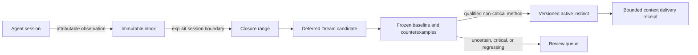

# Shared instincts and Dream

Shared instincts guide an agent's judgment when choosing names, decomposing
work and deciding which proportionate action to take. Dream revises them from
attributable experience.

## Ownership

| Concern | Owner |
| --- | --- |
| Project scope, decisions, stages and gates | Pulse ICM |
| Code relationships | Repository sources, search tools and ICM references |
| Task procedure | Pulse or project skill |
| Situational judgement | Shared instinct definition and method-evaluation evidence |
| Runtime experience consolidation | Dream candidate pipeline |

The store uses `/media/jerem/ubuntu2/agent-instincts/jerem/`, checks the ubuntu2
UUID before writing and caps its complete contents at 256 MiB. Immutable YAML
definitions live under `.instincts/`, with linked version/evidence records.
One atomic state publication commits observations, closure bounds and active
version pointers. Admission and model capture reserve capacity before writing.

## Lifecycle

An event identifies a range by source, project, session and upper sequence.
Repeating that exact close is idempotent. A resumed session has a later range,
so each later range contains its new observations. Native session end and
explicit host chat/task closure define the supported boundaries.

## Selection and qualification

Context selection is deterministic. It considers explicit common/project scope,
method-evaluation evidence, event, relevant terms and bounded links. The delivered
packet contains at most six complete instincts, follows links at depth two and
is at most 16 KiB. Direct user preferences are attributed and project-scoped by
default. They apply immediately. An inferred wider rule follows qualification.
An explicit common preference, or qualified independent project evidence,
supports common scope. Ambiguous scope stays in review.

Dream uses the existing Claude Code login through a tool-free evaluation mode.
A loopback relay bounds each child to one forwarded request and records the
effective model, effort and tool exposure. The local controller validates and
publishes its results. Activation requires two baseline and two candidate repetitions across a trigger case, a
negative neighbour and an unrelated case, no required-case regression, and exact
evaluator-profile evidence. Native context delivery has its own proof. The default limits are one
candidate/revision per pass, 16 calls/job and 32 calls/day. A timeout or
uncertain submission is `blocked_unknown`. It requires explicit review.
An entire JSON code fence can be parsed. Quotes and verdicts must still match
the retained responses and frozen criteria. Uncertain judgments remain pending.
Completed requests are reusable evidence during an inspected local recovery.

## Runtime coverage

The controller provides working admission, selection, Dream, review, rollback
and maintenance commands. Deployment remains subject to its reviewed manifest.

- Claude Code 2.1.325 has native start/resume/prompt/end and context-transport proof in a temporary profile, with all three MCP tools exposed.
- Codex CLI 0.167.2 has separate start/resume/prompt/end and full-context transport proof. Its hook disables native context spilling after the controller enforces the 16 KiB cap. Its native MCP client lists all three tools.
- Antigravity CLI uses SessionStart/PreInvocation and a managed launcher. Its native evidence appears in the runtime matrix.
- The concrete OpenBot bridge is opt-in, uses a fixed local executable, and adds relevant context to each canonical turn. It retains that prepared input during archived-thread recovery. Explicit task close and chat clear follow host memory handling. Its tested source targets the official 0.60.0 tag. The installed AppImage matches the official release SHA-256. Rebuilding, activation and application-level delivery remain to be verified.

A qualified method is shared with relevant agents in its approved scope.
Each packet identifies its evaluator profile and the consumer's own evidence.
An unverified consumer can receive it with that status visible. A prepared
delivery receipt records the exact context. The runtime matrix records native
transport and behavior separately. Native model trials currently retain their
inconclusive candidates in review.

## Operations

`scripts/pulse_instincts.py` exposes the following operations through JSON stdin.
Native hook responses use the runtime's exact output format.

| Command | Behavior |
| --- | --- |
| `status` | Read capacity, queue, active versions and consumed/reserved quota |
| `select` | Read applicable whole rules and attributed preferences |
| `observe --auto-sequence` | Admit one redacted observation with an atomic session sequence |
| `close` | Admit a session's bounded contribution range |
| `drain --all` | Process bounded queued jobs and run eligible maintenance |
| `review` | List, accept, reject, rollback, save a preference or explicitly resume an inspected interrupted range |
| `adapter` | Handle native context/closure or launch a managed Antigravity session |
| `adapter --stdio` | Serve MCP `select`, `observe` and `remember_preference` with a fixed store root |
| `gc` | Delete eligible successful temporary copies |
| `install --dry-run` | Render exact hook/service deltas and restoration ownership |

Accept/reject requests bind the candidate digest. Rollback also binds the
current active version. Corrections enter through a new attributed observation
and closure, retaining earlier evidence. Critical candidates require an
explicit user approval reference and valid native behavioral qualification.

The pinned dependency lock targets CPython 3.14 on Linux x86_64. Install it
with hash checking in an isolated environment. Deployment uses
`/media/jerem/ubuntu2/agent-instincts/runtime/venv/bin/python3` and an owned
versioned controller release. The service/path units wake the deferred worker.
Each Claude evaluation has its own tool-free, one-request bridge sandbox.
The user service uses the regular user-manager process environment because
additional unit namespace restrictions prevented that sandbox from starting
on this machine. Dream defaults to the configured Claude model with low effort.
`install --dry-run` reports deltas for existing profiles and exact owned-entry
removal for rollback. Publication and application activation have separate receipts.

Temporary Dream copies become eligible for deletion seven days after successful
consolidation. Pending and uncertain evidence remains retained with definitions,
compact supporting evidence and deduplication receipts. Capacity exhaustion
stops intake with a visible refusal. GitNexus is retired on this machine.
