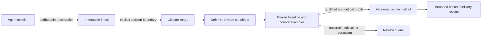

# Shared instincts and Dream

Shared instincts are small behavioural reflexes for agents: when to inspect
existing vocabulary before naming, when to decompose a task, when to take a
small reversible observation before a consequential action, and when to stop.
They are not a transcript archive, a new project lifecycle or model training.

## Ownership

| Concern | Owner |
| --- | --- |
| Project scope, decisions, stages and gates | Pulse ICM |
| Code relationships | GitNexus when its index is declared and fresh |
| Task procedure | Pulse or project skill |
| Situational judgement | Shared instinct definition and qualified profile |
| Runtime experience consolidation | Dream candidate pipeline |

The store is intended for `/media/jerem/ubuntu2/agent-instincts/jerem/`, not a
runtime home. It is capped at 256 MiB, reserves bytes before acknowledgement and
never creates an unmounted-disk fallback. Native Codex/Claude memories and the
retired Claude-mem archive stay separate.

## Lifecycle

An event identifies a range by source, project, session and upper sequence.
Repeating that exact close is idempotent. A resumed session has a later range,
so earlier observations are not re-read. A worker completion, compaction or
ordinary turn end is not a parent session closure.

## Selection and qualification

Context selection is deterministic. It considers explicit common/project scope,
profile qualification, event, relevant terms and bounded links. The delivered
packet contains at most six complete instincts, follows links at depth two and
is at most 16 KiB. Direct user preferences are attributed and project-scoped by
default; they apply immediately but do not become a global inferred instinct.

Dream uses the existing Claude Code account through an isolated, tool-free
evaluation mode. A model response cannot write the store. A future activation
requires two baseline and two candidate repetitions across a trigger case, a
negative neighbour and an unrelated case, no required-case regression, exact
profile evidence and a complete delivery receipt. The default limits are one
candidate/revision per pass, 16 calls/job and 32 calls/day. A timeout or
uncertain submission is `blocked_unknown` and is never replayed automatically.

## Runtime coverage

The repository currently ships controller and adapter contracts, not an enabled
global integration. Claude/Codex have documented session lifecycle hooks;
Antigravity needs a launcher-owned session because `Stop` ends an execution
loop rather than a chat; OpenBot has a source-bound inert patch awaiting proof
against the installed application. See the feature runtime matrix for the live
status. No runtime is marked complete until context delivery, closure and
behaviour evidence exist for its actual version.

## Operations

`scripts/pulse_instincts.py` exposes versioned JSON commands. During this
delivery it intentionally reports installation and deferred operations as
pending; `install --dry-run` is the only allowed installation surface. The
systemd files in `scripts/instincts/service/` are declarative and are neither
copied nor enabled by this feature.

Temporary Dream copies become eligible for deletion seven days after successful
consolidation. Definitions, compact supporting evidence, pending candidates and
receipts required for deduplication are retained; capacity pressure stops new
admission visibly instead of deleting the sole evidence.
